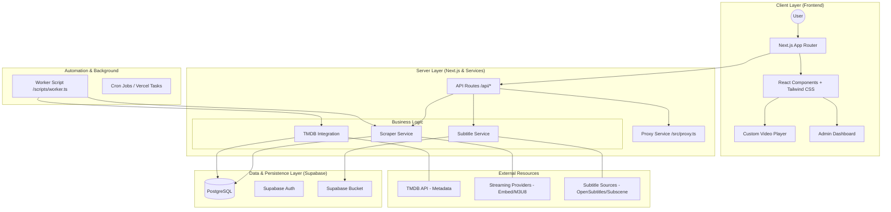

# 🏗️ Arsitektur Sistem NETIX

Aplikasi ini menggunakan arsitektur modern berbasis **Serverless** dan **Event-Driven Automation**. Berikut adalah rincian teknisnya.

## 1. Diagram Arsitektur

---

## 2. Lapisan Layanan (Service Layer)

### **A. Scraper Service**
Bertanggung jawab untuk:
- Menemukan konten baru dari TMDB.
- Mencari link streaming (embed) dari provider luar.
- Mengklasifikasikan tipe konten (Movie vs TV Show).
- Menyimpan data secara efisien ke Supabase.

### **B. Subtitle Service**
Bertanggung jawab untuk:
- Mencari subtitle berdasarkan TMDB ID.
- Mengunduh dan membersihkan file subtitle.
- Menyimpan file ke Supabase Storage agar siap diputar oleh video player.

### **C. Health Check Service**
Bertanggung jawab untuk:
- Memverifikasi apakah link streaming masih aktif.
- Menandai konten "Unhealthy" di database agar tidak ditampilkan atau memicu pencarian link baru.

---

## 3. Aliran Data (Data Flow)

1. **Ingestion**: Scraper mengambil data dari TMDB API.
2. **Enrichment**: Metadata tambahan (aktor, poster, genre) digabungkan.
3. **Storage**: Data disimpan ke PostgreSQL.
4. **Consumption**: Frontend (Next.js) menarik data melalui Supabase SDK dan merendernya ke pengguna.
5. **Playback**: Video player memanggil link dari database dan memuat subtitle dari storage.

---

## 4. Keamanan & Performa
- **RLS (Row Level Security)**: Memastikan hanya admin yang bisa memodifikasi konten, sementara user hanya bisa membaca konten yang "Approved".
- **Server Side Rendering (SSR)**: Digunakan pada halaman `/watch` agar metadata film terbaca oleh bot (SEO) dan mempercepat pemuatan awal.
- **Image Optimization**: Menggunakan komponen `next/image` untuk mengoptimalkan poster dari TMDB secara otomatis.
